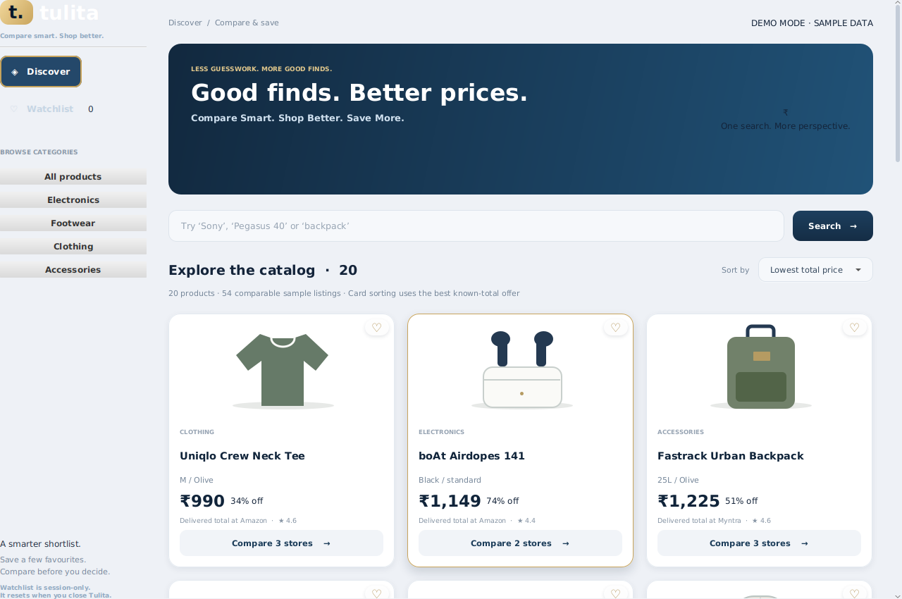
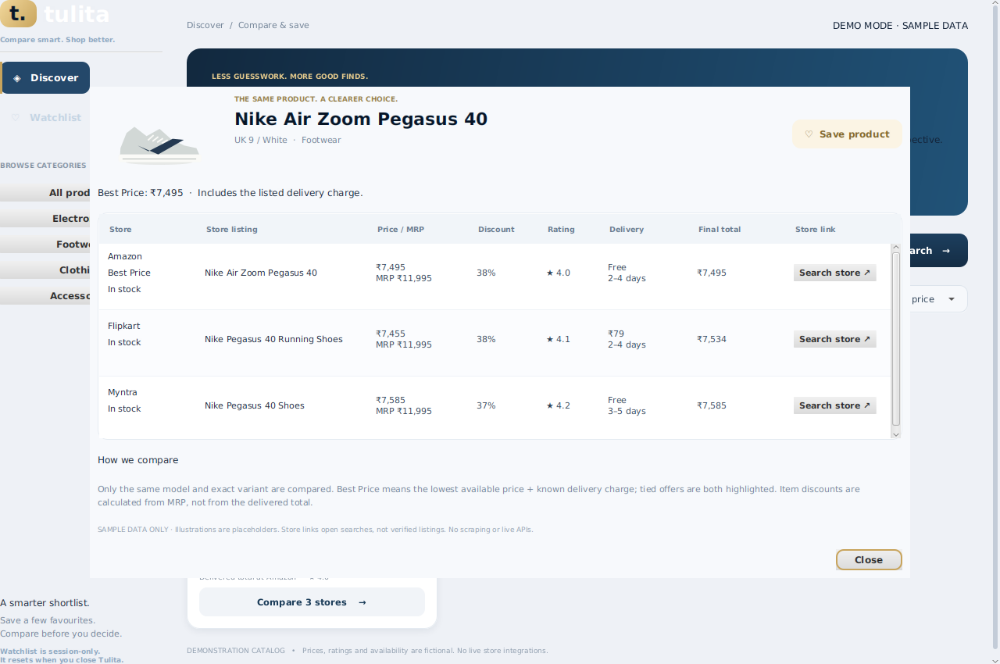
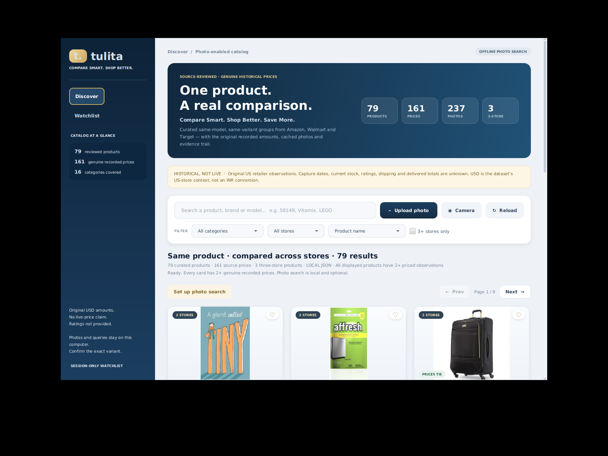

# Tulita — Smart E-Commerce Price Comparison System
**Compare Smart. Shop Better. Save More.**

A **JavaFX desktop application**, not a website: Java 17/21, JavaFX, Maven, MySQL 8/JDBC and MVC, with genuine historical same-product comparisons, local product photos, text search and optional offline visual matching. The default bundled catalog is now a curated 79-product ProMap subset with source-reviewed pricing, local images and a desktop-first workflow.

## Project snapshots

Recent views from the Tulita desktop app:

## What this edition fixes
The earlier independent India-store datasets usually had only one usable observation for a product. This new default **`catalog` mode** uses a **79-product, source-reviewed ProMap subset** so the curated same-product behaviour is much more trustworthy and the app remains fully local to the desktop environment.
