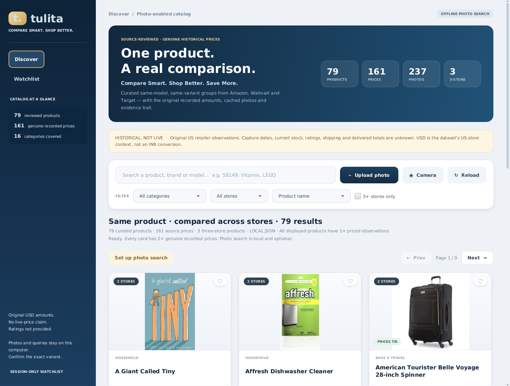
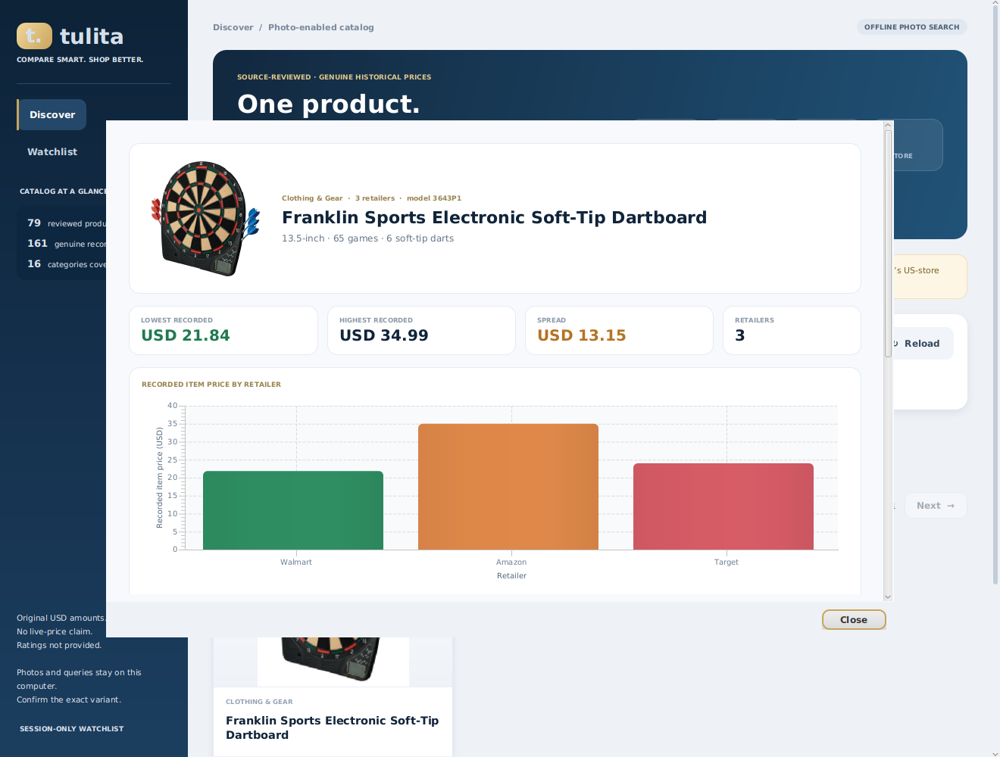
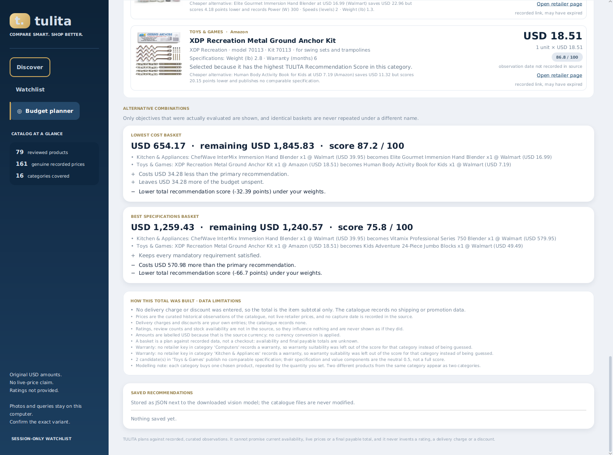
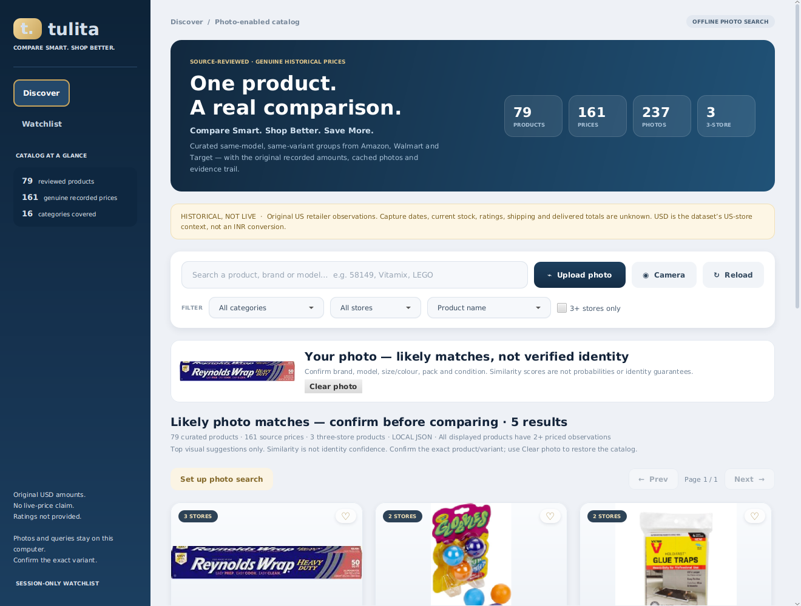

# Tulita — Smart E-Commerce Price Comparison System

**Compare Smart. Shop Better. Save More.**

Tulita is a JavaFX desktop application for exploring product listings, comparing recorded prices for curated product variants, finding products by text or image, and planning a shopping basket within a budget. It is built with Java 17/21, JavaFX, Maven and MVC; MySQL 8/JDBC is optional. The default catalog runs locally from bundled data—Tulita is not a website, does not fetch live retailer prices, and does not require MySQL for its usual catalog mode.

## Project snapshots

The screenshots below show the desktop application and its main workflows.









## What the app does

- **Explore a curated catalog:** browse 79 reviewed product variants, search by product name, brand or model, and filter or sort the results. The bundled subset contains 161 original price observations and 237 cached reference photos across 10 categories.
- **Compare recorded offers:** compare offers for the selected product variant, view the lowest and highest recorded amounts and price spread, inspect source details, and open the retained retailer links when available. The catalog has two or more offers for every product; three products have offers from three retailers.
- **Plan a basket:** choose categories, quantities and an objective—Best Value, Lowest Cost, Best Specifications or Balanced. The planner accounts for user-entered delivery and discount assumptions, can accept a user-supplied INR/USD rate, explains recommendations, and supports saving and exporting plans. See [the budget optimizer guide](docs/BUDGET_OPTIMIZER.md).
- **Search with a photo:** optionally use a local pretrained image model through Java and ONNX Runtime to find visually similar catalog products. Upload-photo search works without a webcam; camera capture is also available on supported desktop systems. Visual similarity is a suggestion, not proof of product identity.
- **Use local or database-backed data:** the default catalog runs from bundled files. MySQL 8 is an optional JDBC path for users who want to set up the database-backed catalog.

## Important data notes

The displayed prices are historical source observations, **not live prices**. The project does not refresh retailer pages, check current stock, or include shipping, promotions or ratings that are absent from the source data. The smallest displayed amount is therefore described as the lowest recorded price, not a guaranteed current best price. No ratings or price-history timeline are invented.

The curated comparison data comes from a reviewed ProMap subset. Source records, attribution, curation information and licensing notes are in [`datasets/promap/ATTRIBUTION.md`](datasets/promap/ATTRIBUTION.md). Please read them before redistributing data or images.

## Run the desktop app from source

### Requirements

- 64-bit JDK 21 recommended (the project source targets Java 17).
- Maven 3.9 or later.
- A graphical desktop environment for the JavaFX UI.
- MySQL 8 only if you choose the database-backed mode.

### Windows

Open the project folder containing `pom.xml` in VS Code or a terminal, then run:

```powershell
$env:TULITA_MODE = 'catalog'
$env:TULITA_DATA_SOURCE = 'csv'
mvn clean test
mvn javafx:run
```

Or double-click `run-catalog.bat` to launch the catalog mode.

### Linux or macOS

From the project directory, run:

```bash
TULITA_MODE=catalog TULITA_DATA_SOURCE=csv mvn javafx:run
```

Keep the project files and bundled `datasets/` folder together. The optional visual-search model requires a one-time download and is not included in the repository by default. For detailed setup, troubleshooting and packaging instructions, see [Run in VS Code](docs/RUN-IN-VSCODE.md), [Photo search and camera](docs/MODEL_AND_CAMERA.md) and [Packaging](docs/PACKAGING.md).

## Run without installing Java or Maven

Build a self-contained app on the target operating system using a full JDK with `jpackage` available:

```bat
package-app.bat
```

```bash
./package-app.sh
```

Share the generated `dist/Tulita` app folder with users of the **same operating system**. The package includes a runtime and the catalog assets. See [packaging details and platform limitations](docs/PACKAGING.md). Tulita is currently a desktop JavaFX app; Android, iOS and browser use require a separate implementation.

## Project structure

- `src/main/java/tulita/` — JavaFX application, catalog and comparison workflows, photo search, budget planner, data-access code and supporting services.
- `src/main/resources/` — app styles, fonts and legacy resources.
- `datasets/promap/` — curated catalog data, source records, attribution and product photos.
- `docs/` — setup, architecture, verification, packaging and feature documentation, plus screenshots.
- `matching/` — documentation and tools for reviewing same-product mappings.

The application follows MVC and separates JavaFX views/controllers from catalog services and local/JDBC data access. Run the test suite with:

```bash
mvn clean verify
```

## Browser edition

A separate browser preview is being maintained on the [`web-version` branch](https://github.com/abhishek45jha-lab/TULITA-/tree/web-version/web). It is distinct from this JavaFX desktop build; its browser features and deployment setup are documented in [`web/README.md`](https://github.com/abhishek45jha-lab/TULITA-/blob/web-version/web/README.md). A live hosted URL is not included here because it depends on the Vercel deployment being configured.
