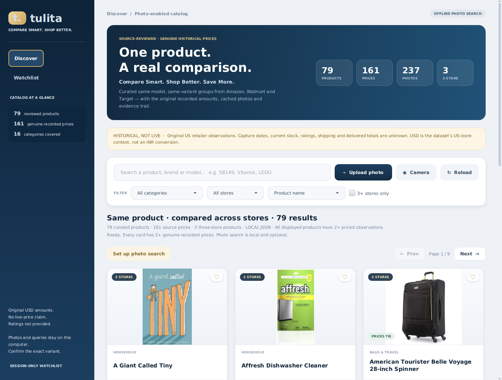
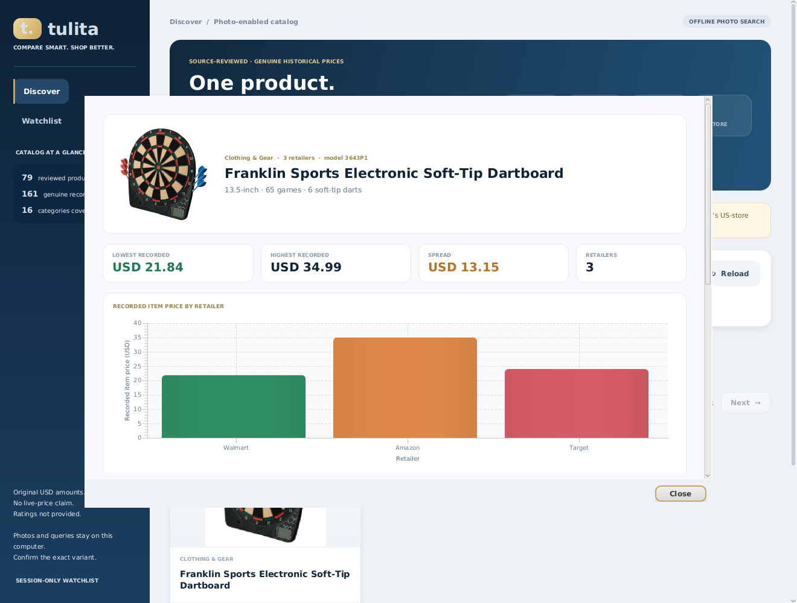
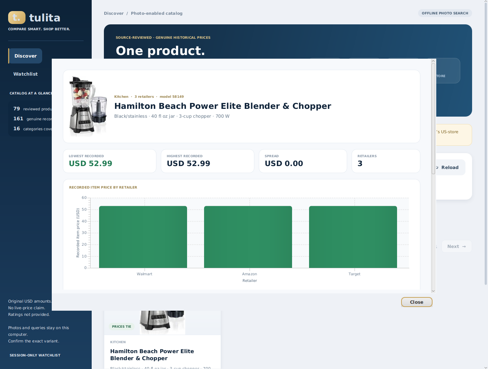
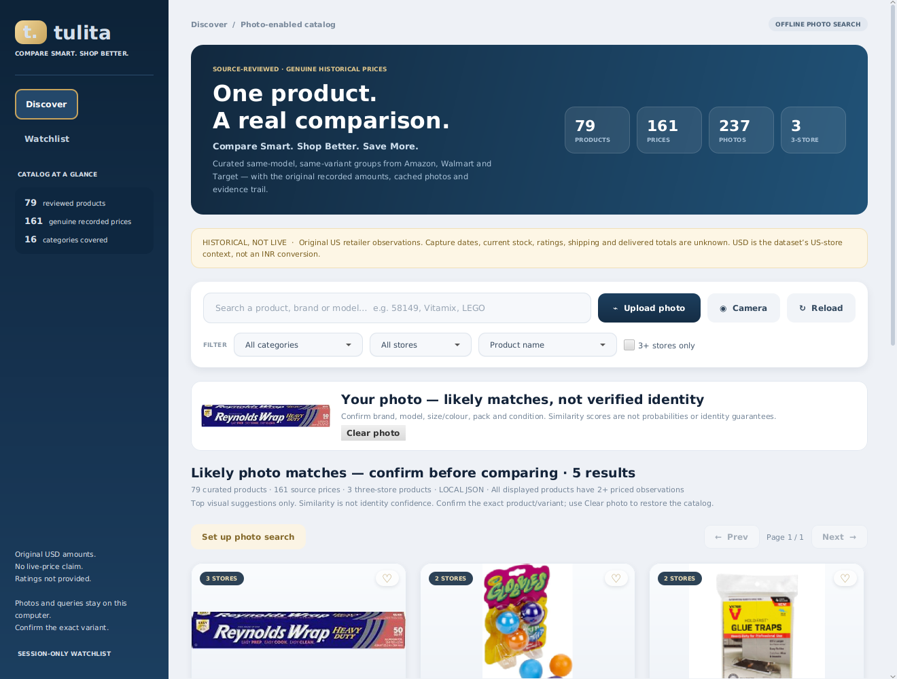

# Tulita — Smart E-Commerce Price Comparison System
**Compare Smart. Shop Better. Save More.**

A **JavaFX desktop application**, not a website: Java 17/21, JavaFX, Maven, MySQL 8/JDBC and MVC, with genuine historical same-product comparisons, local product photos, text search and optional offline image search.

## What this edition fixes
The earlier independent India-store datasets usually had only one usable observation for a product. This new default **`catalog` mode** uses a **79-product, source-reviewed ProMap subset** so the comparison workflow can be demonstrated across kitchen appliances, toys, household goods, luggage, pet supplies, health, garden, phones and computers:

| Included data | Count |
|---|---:|
| Curated product variants | **79** |
| Genuine historical priced observations | **161** |
| Cached reference photographs | **237** |
| Products with 2+ priced stores | **All 79** |
| Products with 3 priced stores | **3** |
| Categories covered | **10** |

The selected retailers are **Amazon.com, Walmart and Target**. Sears is supported as a missing comparison slot, but no Sears observations passed this subset's curation; examined rows often had conflicting model details. No Walmart price is renamed as Flipkart or Myntra. The original India-store catalog remains a separate legacy mode.

**No simulated prices are used in this catalog.** Prices remain original numerical observations. USD is assigned from the US retailer context; the research CSV has no currency column. Exact capture dates, current stock, condition guarantees, delivery and final payable totals are unknown. These are historical comparisons, not current shopping offers or independently verified live deals.



### Redesigned desktop workspace
- **Midnight rail + KPI hero** showing products, recorded prices, photos and three-store groups at a glance.
- **Product cards** with a per-retailer price list, lowest amount highlighted, a price-spread badge, tie badge and watchlist heart.
- **Comparison sheet** with lowest / highest / spread / retailer KPIs, a **recorded-price bar chart**, an evidence table and source photos.
- Everything is styled from local CSS — no web fonts or network assets.



**Ratings are not available in this dataset** and are never invented: cards show no stars and the comparison table displays “Not in source”. **A price-over-time graph is not possible either**, because each retailer supplies one undated amount — the app charts the genuine recorded price per retailer instead. Details: [UI, charts and ratings](docs/UI_AND_CHARTS.md).

## 1. Requirements
- **64-bit JDK 21 recommended**; source targets Java 17. Linux JDK 21 was tested; Windows/JDK 17 runtime were not separately certified.
- **Maven 3.9+** on PATH.
- VS Code with **Extension Pack for Java** (or IntelliJ).
- A graphical desktop; a webcam is optional because Upload photo also works.
- Internet for the first Maven dependency download and the optional one-time **89 MB visual-model download**. No paid API/key/account is required.
- MySQL **8.0+** only if you choose the database-backed mode. Local-file mode works without starting MySQL.

A separate JavaFX SDK, Python backend, Node/React, browser server, GPU, cloud recognition service or training pipeline is not required. ONNX Runtime adds native dependencies downloaded through Maven; leave sufficient disk space for Maven and the model.

## 2. Run on Windows in VS Code
1. Extract the complete project ZIP.
2. In VS Code choose **File → Open Folder** and select **`tulita`**, the folder containing `pom.xml`.
3. Keep `datasets/`, `src/`, `matching/` and all project files in place. Do not run from only the `src` folder.
4. Open **Terminal → New Terminal** (PowerShell):

```powershell
java -version
mvn -version
```

Both must use JDK 17/21, not Java 11. Fix JAVA_HOME/PATH and restart VS Code if needed.

5. Run:

```powershell
$env:TULITA_MODE = 'catalog'
$env:TULITA_DATA_SOURCE = 'csv'
mvn clean test
mvn javafx:run
```

Here `csv` is the shared historical local-file setting; this particular curated catalog is stored as JSON with original CSV evidence. It is not a live data download.

**Simpler alternative:** double-click **`run-catalog.bat`**. It selects the correct mode and project directory. Do not use a single Java file's Run button or `java -jar`: the supported launcher is Maven/JavaFX, not a fat-JAR installer.

Linux/macOS with a desktop:

```bash
TULITA_MODE=catalog TULITA_DATA_SOURCE=csv mvn javafx:run
```

## 3. Updating from an earlier Tulita ZIP
The catalog is **bundled local data**, not something you download at run time. To see the 79-product catalog:

1. Close the running app.
2. Keep any `application.properties` you already configured (MySQL password), then replace the old project folder with the extracted new one.
3. Confirm the data arrived:
   ```powershell
   (Get-ChildItem datasets\promap\images\*.jpg).Count
   ```
   Expect **237**. A count of 55 means an old ZIP or a mixed folder is still being used.
4. Start with **`run-catalog.bat`**, then click **Reload catalog**, or simply restart the app. The header must read **79 results**.
5. If you use MySQL mode, re-import once with **`import-photo-catalog.bat`** (it should report *Imported 79 curated genuine products*), then start **`run-catalog-mysql.bat`**.

No internet connection is needed for this step. The only optional download in Tulita is the one-time 89 MB visual-search model; it is cached in `C:\Users\YOUR_NAME\.tulita\` and does not need downloading again.

## 4. Demonstrate real same-product comparisons
### Three-store example: Reynolds Wrap
1. Search **`Reynolds`**.
2. Click **Compare this variant**.
3. The selected product is **Heavy Duty, 50 sq ft, one roll**:

| Store | Original recorded item amount |
|---|---:|
| Walmart | USD 4.98 |
| Amazon | USD 7.29 |
| Target | USD 4.79 |

These amounts come from the retained source records, not generated demo prices. The app labels the smallest as **Lowest recorded item**, not current Best Price, because delivery/current availability/dates are unknown.

### Another three-store example
Search **`58149`** for the **Hamilton Beach Power Elite blender and chopper**. All three recorded item prices are USD 52.99: a real tie, not a forced winner.

### Third three-store example
Search **`dartboard`**. The Franklin Sports 13.5-inch electronic dartboard (65 games, six soft-tip darts) is recorded at Walmart USD 21.84, Amazon USD 34.99 and Target USD 23.99. The Target listing has no model number but matches the other two on board size, game count, dart count and battery type.

### Two-store example
Search **`NutriBullet`**: the selected **ZNB30100Z, light gray, 32 fl oz** pair has Walmart USD 79.87 and Amazon USD 89.99.

Other good demonstrations: **`Vitamix`** (A2300 and 750, both 64 oz black, two stores each), **`LEGO Bookshop`** (set 10270, 2504 pieces), **`LEGO Jurassic`** (75938), **`KitchenAid KCO211BM`**, **`Frigidaire FFMV1846VB`**, **`PRIDE`** pet door, **`Pedigree`** 3.5 lb small-dog food, **`Surface Laptop 3`** (V4C-00064, Sandstone) and **`American Tourister`** Belle Voyage 28-inch.

Every displayed card represents one curated variant and has at least two prices. Search is finite-catalog search, not an unrestricted query of today's stores.

- **3+ stores only** shows the three qualifying products; it is off by default.
- The comparison sheet plots each retailer’s recorded amount and reports the spread, for example the dartboard at USD 21.84 / 34.99 / 23.99 (spread USD 13.15, 38% below the highest).
- Store/category filters, price/name/store-count sorting, pagination and the session-only watchlist work.
- Comparison uses fixed Amazon/Walmart/Target/Sears slots. Missing reviewed observations remain missing.
- **View source** shows the original title, amount, specifications, description, retailer URL, source CSV record/side and SHA-256 evidence.
- Old retailer links may be expired. Opening them is optional and does not refresh the stored price.



## 5. Enable offline photo search
The user approved a local pretrained image model for this edition. Inference runs through **Java + ONNX Runtime**, not Python or a cloud API.

1. Launch the app and click **Set up photo search**.
2. If prompted, approve the one-time 89 MB model download. You can also run **`setup-photo-search.bat`** or:

```powershell
mvn -q compile exec:java '-Dexec.mainClass=tulita.photocatalog.ModelSetupMain'
```

3. Wait for reference-photo indexing to finish.
4. Click **Upload photo**, select a JPG/PNG, and wait for the top five distinct catalog suggestions.
5. Confirm the actual product and exact variant before using **Confirm product & compare**.

Default model location on Windows:

```text
C:\Users\YOUR_NAME\.tulita\clip-vision-int8.onnx
```

**Weights are not bundled in the ZIP.** Download them before an offline college demonstration. The Java installer uses a pinned model revision and verifies its SHA-256. After dependencies/model setup, catalog browsing and image inference use local files; user images are not uploaded.

For a repeatable pipeline demonstration, upload an included photo such as `datasets/promap/images/reynolds-amazon-0.jpg`. That demonstrates the pipeline, **not** recognition accuracy on new camera photographs.

**Important limitations:** visual similarity is not a probability or proof of identity. A photo cannot reliably establish hidden storage, pack quantity, condition or all size variants. An object absent from this small catalog can still have unrelated nearest neighbours. Reject wrong suggestions. There is no calibrated automatic exact-match/rejection classifier. Image results never add prices or merge canonical product groups. Use Clear photo to restore browsing. See [model and camera details](docs/MODEL_AND_CAMERA.md).



## 6. Use the camera
1. Connect/enable a webcam. On Windows, allow desktop camera access under **Settings → Privacy & security → Camera**.
2. Close any other application that is using it.
3. Click **Camera**, wait for a live preview, center one product with good light and a simple background.
4. Click **Capture & find catalog matches**.
5. Review the suggestions and confirm the model/variant.

The default system webcam is used. The frame stays in memory; the app does not save/upload it. Closing the dialog closes the camera. If no device/native driver/permission is available, a visible error disables capture and directs you to Upload photo. The app does not substitute a fake camera frame.

**Physical camera capture was not available in the verification environment.** Success/failure UI flows were tested using explicitly injected test providers; real photo uploads and ONNX inference were tested. Actual Windows webcam hardware/driver compatibility remains to be checked on your machine.

Linux webcam bridge prerequisite (Debian/Ubuntu): install `libv4l-0`, JavaFX GTK libraries and check video-device permissions. Optional diagnostic, which does not save/upload a frame:

```powershell
mvn -q compile exec:java '-Dexec.mainClass=tulita.photocatalog.CameraProbeMain'
```

## 7. MySQL 8 setup — this photo catalog
Local images and original evidence remain under `datasets/promap`; MySQL stores normalized product, offer and photo-reference records.

### A. Schema/account
Open **`photo-catalog-schema.sql`** in MySQL Workbench and execute it. For this default mode you do not need to run the older schemas.

Create a local user as administrator, choosing your own password:

```sql
CREATE USER 'tulita_app'@'localhost' IDENTIFIED BY 'REPLACE_WITH_YOUR_OWN_PASSWORD';
GRANT SELECT, INSERT, UPDATE, DELETE ON tulita.photo_products TO 'tulita_app'@'localhost';
GRANT SELECT, INSERT, UPDATE, DELETE ON tulita.photo_offers TO 'tulita_app'@'localhost';
GRANT SELECT, INSERT, UPDATE, DELETE ON tulita.photo_images TO 'tulita_app'@'localhost';
```

Skip CREATE USER if it already exists. Do not broadly grant remote `%` access. A separate SELECT-only account on the three tables is sufficient for browsing after import.

### B. Private configuration

```powershell
Copy-Item application.properties.example application.properties
```

Edit `db.user`, `db.password` and `db.url` locally. Keep this file private; it is deliberately not supplied with real credentials. Defaults are local-development settings, not a remote-production TLS configuration. Environment overrides take precedence over the file.

### C. Import and launch

```powershell
mvn -q compile exec:java '-Dexec.mainClass=tulita.photocatalog.PhotoCatalogImportMain'
$env:TULITA_MODE = 'catalog'
$env:TULITA_DATA_SOURCE = 'mysql'
mvn javafx:run
```

Or run **`import-photo-catalog.bat`**, followed by **`run-catalog-mysql.bat`**. Import validates local evidence/photo fingerprints and transactionally replaces only the three photo-catalog tables. A SQL error rolls back, with no partial catalog accepted. Missing DB/schema/credentials/import produces a setup error, never a JSON/demo fallback. Keep the local asset folder intact even in MySQL mode.

## 8. Data provenance and licences
Read **[datasets/promap/ATTRIBUTION.md](datasets/promap/ATTRIBUTION.md)** and its manifest before redistribution.

- ProMap/ProMapMulti authors: Kateřina Macková and Martin Pilát; [source repository](https://github.com/kackamac/Product-Mapping-Datasets), pinned commit retained.
- Four untouched source CSVs, original author READMEs, source URLs, per-offer row hashes and cached-image hashes are bundled.
- The 1,800 original pairs include 566 positive-labelled candidates, 382 with both prices. **Positive labels are not accepted blindly.** Of the 356 remaining candidates, 62 were accepted after checking both listings; the rest were rejected when evidence conflicted. `datasets/promap/CURATION_REPORT.json` lists the accepted rows and every rejected pair with the reason, for example Farberware 1.1 vs 0.7 cu ft microwaves, Costway gold vs black/rose-gold, Swagtron pink vs blue, Nexium 42-count capsules vs ClearMinis, and Purina variety packs with different recipes.
- Author README states open use, but the inspected repository supplies no separately named complete dataset licence text. Do not claim CC0/MIT data licensing or blanket clearance of retailer photographs. Preserve attribution; clarify additional commercial/redistribution image rights where needed.
- Cached photographs are source-linked RGB JPEG derivatives, resized to at most 640 px. No new retailer-page scraping is performed.
- CLIP base model MIT licence and conversion/source acknowledgements are retained. The optional pretrained model is not trained by this project.
- Prior India-store source licences and Noto font notices remain with their separate data/assets.

## 9. Architecture and OOP
MVC: JavaFX views → controller → curated catalog/visual services → interchangeable local/JDBC DAOs.

- Immutable `PhotoProduct`, `Offer` and `Photo` records.
- `CatalogValidator`: source-file/row hashes, original amount/title/specification equality, store URL identity, known model consistency, photo URL membership/hash, unique memberships and no single-priced-store cards.
- `CatalogService`: Unicode-aware text lookup, filters, sorting and canonical grouping.
- `VisualSearch`: CPU ONNX inference, local embeddings and distinct-product cosine ranking. Suggestions never establish offer membership.
- `PhotoCatalogController`: background load/model download/index/search, FX-thread UI updates, local session watchlist and resource shutdown.
- `CameraSource` abstraction / `WebcamSource` physical adapter; injectable test providers are confined to tests.
- DAO polymorphism, prepared statements, normalized MySQL tables, transactions/rollback, try-with-resources, collections/comparators and JavaFX inheritance.

## 10. Configuration and retained modes
| Variable | Meaning |
|---|---|
| `TULITA_MODE` | `catalog` (new default), `multistore` (old India-store catalog), `dataset` (old Flipkart-only), `demo` / `mysql` (explicitly fictional legacy demo) |
| `TULITA_DATA_SOURCE` | `csv` local-file / `mysql` database historical mode |
| `TULITA_PHOTO_CATALOG_ROOT` | Optional curated asset directory; default `datasets/promap` |
| `TULITA_VISION_MODEL_PATH` | Optional pinned CLIP weights path |
| `TULITA_DB_URL`, `TULITA_DB_USER`, `TULITA_DB_PASSWORD` | Private JDBC settings |

The previous 52,491 India-store records and header-only reviewed-mapping workflow remain separate, unmodified and do not fill this catalog's prices. Older instructions are archived in `docs/LEGACY_SAME_PRODUCT_README.md` (paths in that archive refer to the project root). Original fictional demos are never mixed into the genuine default catalog.

## 11. Tests and troubleshooting

```powershell
mvn clean verify
```

**104 tests discovered: 94 execute by default; 10 optional desktop/model/database tests skip.** All 104 passed in verification. On a machine with about 2 GB RAM, run the JavaFX/model UI class separately from the database tests (`-Dtest=PhotoCatalogUiTest`) if a forked test JVM is killed for memory. Optional new flags: `tulita.photoVisionTests`, `tulita.photoUiTests`, `tulita.photoMysqlTests`. Model tests require the installed weights. GUI tests require a desktop/Xvfb. DB tests are destructive and must never point to a working database; the new DB test requires a dedicated URL containing `tulita_review_test`. See [actual verification](docs/VERIFICATION.md).

| Issue | Action |
|---|---|
| Old/empty India-store view opens | Use `run-catalog.bat` or set `TULITA_MODE=catalog`; stale environment variables override properties. |
| Java 11 / invalid release 17 | Correct JAVA_HOME/PATH and check `mvn -version`. |
| No pom.xml | Run from the extracted `tulita` folder. |
| Missing JavaFX runtime | Use `mvn javafx:run`, not a single Java file or `java -jar`. |
| Photo model missing | Run setup once with internet before the demonstration. |
| Wrong model hash | Remove/replace that incorrect file, then rerun setup. No silent alternate model is used. |
| Camera unavailable | Check permissions, drivers and other camera apps; use Upload photo. Physical devices were not tested here. |
| No stars / ratings shown | The bundled dataset has no rating column. This is intentional rather than a bug; see [UI, charts and ratings](docs/UI_AND_CHARTS.md). |
| Weak/wrong image suggestions | Improve lighting/background/crop, try another view, or use text search. Confirm variants; the catalog has only 79 curated products. |
| No products after filters | Clear text/category/store/three-store/watch filters, or Clear photo. |
| MySQL load fails | Run `photo-catalog-schema.sql`, configure credentials, import with `PhotoCatalogImportMain`; keep local assets. |
| Missing/changed data/photo | Extract the complete ZIP. Hash checks deliberately reject altered evidence/assets. |
| INR/current stock/shipping absent | This source supplies historical US-store item amounts only; missing information is not invented. |

No native Windows installer, live price refresh, login, payments, checkout or cloud service is included. Runtime/platform/camera limitations are stated rather than represented as tested guarantees.
